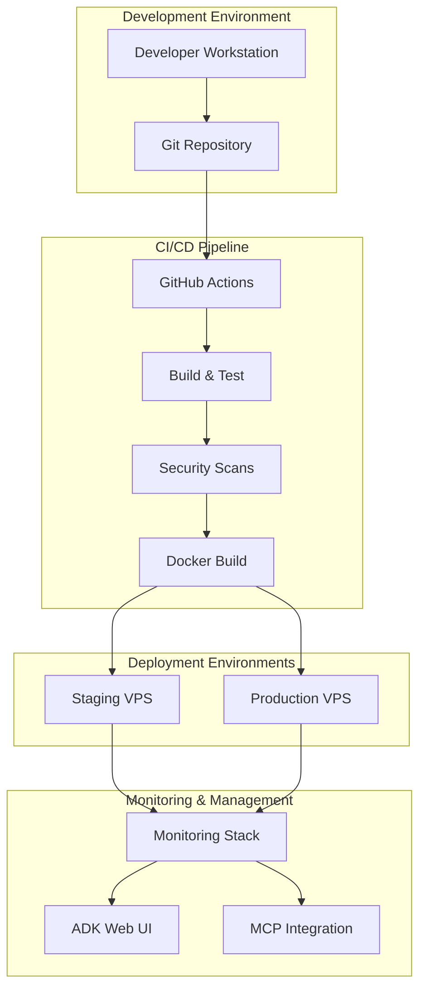
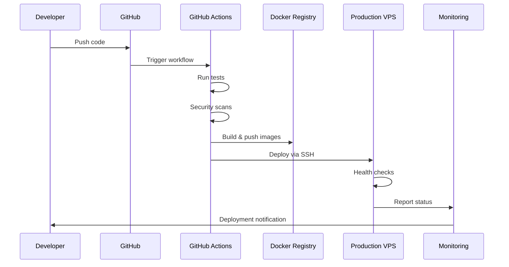

# Design Document

## Overview

The agentic CI/CD pipeline design implements a comprehensive automation system that integrates with the existing dual-agent architecture (CustomerJourneyAgent and N8nMCPAgent) while maintaining the production-ready status. The pipeline leverages GitHub Actions for CI/CD orchestration, Docker for containerization, and integrates seamlessly with the current tech stack including Supabase, n8n, MCP, and the ADK framework.

## Architecture

### High-Level Architecture



### Pipeline Flow Architecture



## Components and Interfaces

### 1. GitHub Actions Workflow Engine

**Purpose**: Orchestrates the entire CI/CD pipeline
**Location**: `.github/workflows/`

**Key Components**:
- `ci.yml`: Main CI pipeline for testing and building
- `cd-staging.yml`: Staging deployment pipeline
- `cd-production.yml`: Production deployment pipeline
- `security.yml`: Security scanning and compliance checks

**Interfaces**:
- GitHub API for repository events
- Docker Registry API for image management
- SSH connections to VPS instances
- Slack/Discord webhooks for notifications

### 2. Build and Test System

**Purpose**: Automated testing and quality assurance
**Location**: `scripts/ci/`

**Key Components**:
- Frontend test runner (Next.js/Jest)
- Backend test runner (Python/pytest)
- Integration test suite
- Performance test suite
- Code coverage analysis

**Interfaces**:
- ADK evaluation framework
- Supabase test database
- Mock service implementations
- Test result reporting APIs

### 3. Docker Container Management

**Purpose**: Containerization and deployment consistency
**Location**: `docker/`

**Key Components**:
- Multi-stage Dockerfiles for frontend and backend
- Docker Compose orchestration files
- Environment-specific configurations
- Health check implementations

**Interfaces**:
- Docker Registry (GitHub Container Registry)
- VPS Docker daemon
- Container orchestration APIs
- Health check endpoints

### 4. VPS Infrastructure Management

**Purpose**: Server provisioning and configuration
**Location**: `infrastructure/`

**Key Components**:
- Ansible playbooks for server setup
- SSH key management
- SSL certificate automation
- System monitoring configuration

**Interfaces**:
- SSH protocol for server access
- Let's Encrypt API for SSL certificates
- System package managers
- Monitoring agent APIs

### 5. MCP Integration Layer

**Purpose**: Workflow automation and agent management
**Location**: `agent/my_adk_agent/services/cicd_service.py`

**Key Components**:
- MCP deployment automation
- n8n workflow synchronization
- Agent configuration updates
- Workflow validation system

**Interfaces**:
- MCP Server API
- n8n REST API
- ADK agent communication
- Workflow validation endpoints

### 6. Security and Compliance System

**Purpose**: Automated security scanning and compliance
**Location**: `security/`

**Key Components**:
- Static code analysis (SonarQube/CodeQL)
- Dependency vulnerability scanning
- Container security scanning
- Compliance validation

**Interfaces**:
- Security scanning APIs
- Vulnerability databases
- Compliance reporting systems
- Alert notification services

### 7. Monitoring and Alerting System

**Purpose**: System health monitoring and incident response
**Location**: `monitoring/`

**Key Components**:
- Application performance monitoring
- Infrastructure monitoring
- Log aggregation and analysis
- Alert management system

**Interfaces**:
- ADK web UI monitoring integration
- Prometheus/Grafana stack
- Log shipping APIs
- Notification services (Slack, email)

## Data Models

### 1. Deployment Record

```typescript
interface DeploymentRecord {
  id: string;
  commit_sha: string;
  branch: string;
  environment: 'staging' | 'production';
  status: 'pending' | 'running' | 'success' | 'failed' | 'rolled_back';
  started_at: timestamp;
  completed_at: timestamp;
  deployed_by: string;
  build_artifacts: {
    frontend_image: string;
    backend_image: string;
    version: string;
  };
  test_results: {
    unit_tests: TestResult[];
    integration_tests: TestResult[];
    security_scans: SecurityResult[];
  };
  rollback_info?: {
    previous_deployment_id: string;
    rollback_reason: string;
  };
}
```

### 2. Pipeline Configuration

```typescript
interface PipelineConfig {
  id: string;
  environment: string;
  docker_config: {
    registry: string;
    frontend_image: string;
    backend_image: string;
  };
  vps_config: {
    host: string;
    ssh_key_path: string;
    deploy_path: string;
  };
  monitoring_config: {
    health_check_url: string;
    alert_endpoints: string[];
  };
  mcp_config: {
    server_url: string;
    workflow_sync_enabled: boolean;
  };
}
```

### 3. Test Result Schema

```typescript
interface TestResult {
  suite_name: string;
  test_count: number;
  passed: number;
  failed: number;
  skipped: number;
  duration: number;
  coverage_percentage?: number;
  failed_tests?: {
    name: string;
    error_message: string;
    stack_trace: string;
  }[];
}
```

### 4. Security Scan Result

```typescript
interface SecurityResult {
  scan_type: 'sast' | 'dependency' | 'container' | 'infrastructure';
  vulnerabilities: {
    severity: 'critical' | 'high' | 'medium' | 'low';
    count: number;
    details: {
      id: string;
      description: string;
      file_path?: string;
      line_number?: number;
      remediation?: string;
    }[];
  };
  compliance_status: {
    gdpr_compliant: boolean;
    security_standards_met: boolean;
    issues: string[];
  };
}
```

## Error Handling

### 1. Pipeline Failure Recovery

**Strategy**: Implement comprehensive error handling with automatic recovery mechanisms

**Implementation**:
- Retry logic for transient failures (network issues, temporary service unavailability)
- Automatic rollback for failed deployments
- Circuit breaker pattern for external service integrations
- Graceful degradation when non-critical services fail

**Error Categories**:
- **Build Failures**: Code compilation errors, test failures
- **Deployment Failures**: Container startup issues, health check failures
- **Infrastructure Failures**: VPS connectivity issues, resource constraints
- **Integration Failures**: MCP communication errors, database connection issues

### 2. Rollback Mechanisms

**Automatic Rollback Triggers**:
- Health check failures after deployment
- Critical error rate exceeding threshold
- Performance degradation beyond acceptable limits
- Manual rollback trigger via ADK web UI

**Rollback Process**:
1. Stop new traffic routing to failed deployment
2. Restore previous container versions
3. Revert database migrations if necessary
4. Validate system health post-rollback
5. Notify team of rollback completion

### 3. Monitoring and Alerting

**Alert Levels**:
- **Critical**: System down, data loss risk, security breach
- **Warning**: Performance degradation, non-critical service failures
- **Info**: Successful deployments, routine maintenance

**Alert Channels**:
- Slack integration for team notifications
- Email alerts for critical issues
- ADK web UI dashboard updates
- SMS alerts for production emergencies

## Testing Strategy

### 1. Automated Testing Pyramid

**Unit Tests** (70% of test coverage):
- Frontend component tests (Jest/React Testing Library)
- Backend service tests (pytest)
- Agent tool tests (ADK evaluation framework)
- Utility function tests

**Integration Tests** (20% of test coverage):
- API endpoint tests
- Database integration tests
- Service-to-service communication tests
- MCP integration tests

**End-to-End Tests** (10% of test coverage):
- User journey tests
- Agent workflow tests
- Cross-service integration tests
- Performance regression tests

### 2. Test Environment Management

**Test Data Management**:
- Automated test data seeding
- Database state isolation between tests
- Mock service implementations for external APIs
- Test environment cleanup after runs

**Parallel Test Execution**:
- Frontend and backend tests run in parallel
- Test sharding for faster execution
- Resource isolation to prevent test interference
- Consolidated test reporting

### 3. Quality Gates

**Pre-deployment Checks**:
- Minimum 80% code coverage requirement
- Zero critical security vulnerabilities
- All integration tests passing
- Performance benchmarks met
- Code quality metrics satisfied

**Deployment Validation**:
- Health check endpoints responding
- Database migrations completed successfully
- All services reporting healthy status
- Monitoring systems receiving data
- User-facing features functional

## Implementation Phases

### Phase 1: Core CI Pipeline (Week 1-2)
- Set up GitHub Actions workflows
- Implement basic build and test automation
- Configure Docker image building
- Set up test environment

### Phase 2: Deployment Automation (Week 3-4)
- Implement VPS deployment scripts
- Configure staging and production environments
- Set up health checks and rollback mechanisms
- Integrate with existing Docker setup

### Phase 3: MCP Integration (Week 5-6)
- Develop MCP deployment automation
- Implement n8n workflow synchronization
- Configure agent update mechanisms
- Test workflow validation system

### Phase 4: Security and Monitoring (Week 7-8)
- Implement security scanning pipeline
- Set up comprehensive monitoring
- Configure alerting systems
- Integrate with ADK web UI monitoring

### Phase 5: Optimization and Documentation (Week 9-10)
- Performance optimization
- Documentation completion
- Team training and handover
- Production readiness validation