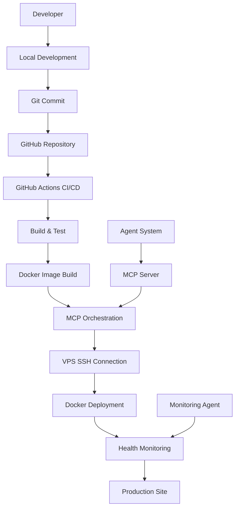

# Design Document

## Overview

The Agentic Deployment Pipeline is a comprehensive CI/CD system that automates the development, testing, and deployment of AI-powered applications. The system leverages existing infrastructure including Docker containers, GitHub Actions, VPS deployment via SSH, and MCP (Model Context Protocol) for orchestration. The design builds upon the current dual-agent architecture with Next.js frontend and Python ADK backend.

## Architecture

### System Components



### Core Architecture Principles

1. **Agent-Driven Automation**: The deployment pipeline is orchestrated by AI agents using MCP for communication
2. **Containerized Deployment**: All services run in Docker containers for consistency across environments
3. **Dual-Service Architecture**: Maintains separation between Next.js frontend and Python ADK backend
4. **SSH-Based VPS Deployment**: Secure remote deployment using SSH key authentication
5. **Health-First Monitoring**: Continuous health checks with automatic rollback capabilities

## Components and Interfaces

### 1. Development Environment Agent

**Purpose**: Manages local development workflow and code quality

**Interfaces**:
- File system monitoring for code changes
- Git integration for version control
- Code quality validation (linting, type checking)
- Local Docker environment management

**Key Methods**:
```python
class DevelopmentAgent:
    def monitor_code_changes(self) -> None
    def validate_code_quality(self) -> ValidationResult
    def prepare_for_deployment(self) -> DeploymentPackage
    def manage_local_containers(self) -> ContainerStatus
```

### 2. GitHub Integration Agent

**Purpose**: Handles Git operations and GitHub workflow triggers

**Interfaces**:
- GitHub API for repository management
- Git CLI for local operations
- Webhook handling for CI/CD triggers
- Branch and PR management

**Key Methods**:
```python
class GitHubAgent:
    def commit_changes(self, message: str) -> CommitResult
    def push_to_repository(self) -> PushResult
    def trigger_workflow(self, workflow_name: str) -> WorkflowResult
    def handle_webhook(self, payload: dict) -> WebhookResponse
```

### 3. CI/CD Orchestration Agent

**Purpose**: Manages the continuous integration and deployment pipeline

**Interfaces**:
- GitHub Actions API
- Docker build system
- Test execution framework
- Artifact management

**Key Methods**:
```python
class CICDAgent:
    def run_tests(self) -> TestResults
    def build_containers(self) -> BuildResults
    def validate_deployment_readiness(self) -> ValidationResult
    def manage_artifacts(self) -> ArtifactStatus
```

### 4. VPS Deployment Agent

**Purpose**: Handles secure deployment to remote VPS via SSH

**Interfaces**:
- SSH client for secure connections
- Docker remote API
- File transfer protocols
- System monitoring

**Key Methods**:
```python
class VPSDeploymentAgent:
    def establish_ssh_connection(self) -> SSHConnection
    def transfer_deployment_files(self) -> TransferResult
    def execute_deployment_commands(self) -> DeploymentResult
    def verify_deployment_health(self) -> HealthStatus
```

### 5. MCP Orchestration Service

**Purpose**: Coordinates communication between all agents and services

**Interfaces**:
- MCP protocol implementation
- Agent communication bus
- Event streaming
- State management

**Key Methods**:
```python
class MCPOrchestrator:
    def coordinate_deployment(self) -> OrchestrationResult
    def handle_agent_communication(self) -> CommunicationResult
    def manage_deployment_state(self) -> StateResult
    def provide_real_time_updates(self) -> UpdateStream
```

### 6. Monitoring and Health Agent

**Purpose**: Continuous monitoring of deployed applications with automatic recovery

**Interfaces**:
- Health check endpoints
- Log aggregation
- Alert systems
- Recovery mechanisms

**Key Methods**:
```python
class MonitoringAgent:
    def perform_health_checks(self) -> HealthReport
    def aggregate_logs(self) -> LogSummary
    def detect_issues(self) -> IssueReport
    def attempt_recovery(self) -> RecoveryResult
```

## Data Models

### Deployment Configuration
```python
@dataclass
class DeploymentConfig:
    project_name: str
    environment: str
    docker_compose_file: str
    vps_host: str
    ssh_key_path: str
    health_check_url: str
    rollback_enabled: bool
    monitoring_config: MonitoringConfig
```

### Build Artifact
```python
@dataclass
class BuildArtifact:
    build_id: str
    commit_hash: str
    docker_images: List[DockerImage]
    test_results: TestResults
    build_timestamp: datetime
    deployment_ready: bool
```

### Deployment Status
```python
@dataclass
class DeploymentStatus:
    deployment_id: str
    status: DeploymentState
    current_step: str
    progress_percentage: int
    logs: List[LogEntry]
    health_status: HealthStatus
    rollback_available: bool
```

## Error Handling

### Error Categories

1. **Development Errors**: Code quality issues, test failures, build problems
2. **Integration Errors**: Git conflicts, GitHub API failures, webhook issues
3. **Deployment Errors**: SSH connection failures, Docker build/run issues, VPS problems
4. **Runtime Errors**: Application crashes, health check failures, performance issues

### Error Handling Strategy

```python
class ErrorHandler:
    def handle_development_error(self, error: DevelopmentError) -> ErrorResponse:
        # Provide code quality feedback and suggestions
        
    def handle_integration_error(self, error: IntegrationError) -> ErrorResponse:
        # Resolve Git conflicts, retry API calls
        
    def handle_deployment_error(self, error: DeploymentError) -> ErrorResponse:
        # Attempt rollback, provide diagnostic information
        
    def handle_runtime_error(self, error: RuntimeError) -> ErrorResponse:
        # Automatic recovery, alerting, log analysis
```

### Rollback Mechanism

1. **Automatic Rollback Triggers**:
   - Health check failures after deployment
   - Critical application errors
   - Performance degradation beyond thresholds

2. **Rollback Process**:
   - Stop current containers
   - Restore previous Docker images
   - Verify rollback health
   - Update deployment status

## Testing Strategy

### Test Levels

1. **Unit Tests**: Individual agent and service testing
2. **Integration Tests**: Agent communication and MCP protocol testing
3. **End-to-End Tests**: Complete deployment pipeline testing
4. **Performance Tests**: Load testing and resource utilization
5. **Security Tests**: SSH security, container security, API security

### Test Automation

```python
class TestSuite:
    def run_unit_tests(self) -> TestResults
    def run_integration_tests(self) -> TestResults
    def run_e2e_tests(self) -> TestResults
    def run_performance_tests(self) -> TestResults
    def run_security_tests(self) -> TestResults
```

### Test Environments

- **Local Development**: Docker Compose with test containers
- **CI Environment**: GitHub Actions runners with isolated environments
- **Staging VPS**: Separate VPS instance for pre-production testing
- **Production VPS**: Live deployment environment with monitoring

## Security Considerations

### SSH Security
- Key-based authentication only
- SSH key rotation policies
- Connection timeout and retry limits
- Audit logging of all SSH operations

### Container Security
- Non-root user execution
- Minimal base images
- Security scanning of Docker images
- Network isolation between services

### API Security
- GitHub token management
- MCP protocol encryption
- Rate limiting and throttling
- Input validation and sanitization

## Performance Optimization

### Build Optimization
- Docker layer caching
- Parallel build processes
- Incremental builds
- Artifact caching

### Deployment Optimization
- Blue-green deployment strategy
- Rolling updates for zero downtime
- Resource allocation optimization
- Connection pooling for SSH

### Monitoring Optimization
- Efficient health check intervals
- Log rotation and compression
- Metric aggregation
- Alert throttling

## Integration Points

### Existing System Integration
- **Next.js Frontend**: Maintains current functionality with enhanced deployment
- **Python ADK Backend**: Integrates with MCP for deployment orchestration
- **Supabase Database**: Stores deployment logs and configuration
- **Docker Infrastructure**: Builds upon existing containerization
- **GitHub Repository**: Enhances current CI/CD workflow

### External Service Integration
- **GitHub Actions**: Extended workflow for deployment automation
- **VPS Provider**: SSH-based deployment to remote servers
- **MCP Server**: Communication protocol for agent coordination
- **Monitoring Services**: Health checks and alerting integration