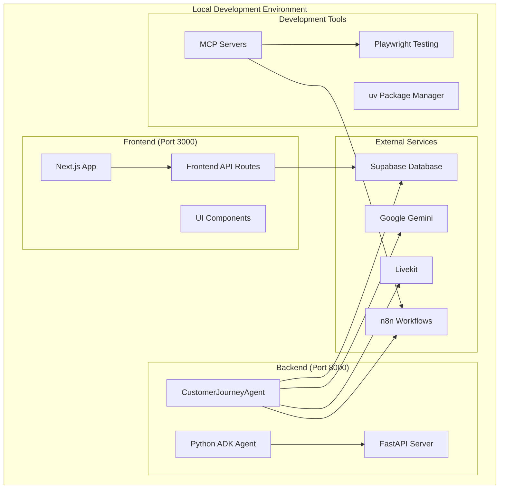

# Design Document

## Overview

This design outlines a comprehensive local testing strategy for the Agentic AI Platform's dual-stack architecture. The system consists of a Next.js frontend and Python ADK backend that need to be tested independently and together without Docker containers, while the production system runs on a VPS in Docker containers.

## Architecture

### Local Development Architecture



### Testing Strategy Layers

1. **Unit Testing**: Individual component testing
2. **Integration Testing**: Service-to-service communication
3. **End-to-End Testing**: Full user journey testing
4. **Performance Testing**: Load and stress testing
5. **Compatibility Testing**: Cross-browser and environment testing

## Components and Interfaces

### Frontend Testing Components

#### Development Server Configuration
- **Port**: 3000 (configurable via environment)
- **Hot Reload**: Enabled for rapid development
- **Source Maps**: Enabled for debugging
- **TypeScript**: Strict mode enabled

#### Testing Interfaces
```typescript
interface FrontendTestConfig {
  port: number;
  apiUrl: string;
  supabaseUrl: string;
  supabaseKey: string;
  environment: 'development' | 'test';
}

interface ComponentTestSuite {
  unitTests: string[];
  integrationTests: string[];
  e2eTests: string[];
}
```

### Backend Testing Components

#### ADK Agent Configuration
- **Framework**: Google ADK with FastAPI
- **Port**: 8000 (configurable)
- **Environment**: Development with debug logging
- **Package Manager**: uv for dependency management

#### Service Testing Interfaces
```python
class BackendTestConfig:
    port: int = 8000
    debug: bool = True
    supabase_url: str
    supabase_key: str
    gemini_api_key: str
    environment: str = "development"

class AgentTestSuite:
    unit_tests: List[str]
    integration_tests: List[str]
    service_tests: List[str]
```

### Integration Testing Components

#### Health Check System
- **Frontend Health**: `/api/health` endpoint
- **Backend Health**: `/health` endpoint
- **Service Health**: Individual service status checks
- **Database Health**: Supabase connection validation

#### Communication Testing
- **API Endpoints**: REST API testing between frontend and backend
- **Database Operations**: CRUD operations testing
- **Real-time Features**: WebSocket and real-time subscription testing

## Data Models

### Test Configuration Model
```typescript
interface LocalTestConfig {
  frontend: {
    port: number;
    buildMode: 'development' | 'production';
    features: string[];
  };
  backend: {
    port: number;
    agentMode: 'development' | 'test';
    services: ServiceConfig[];
  };
  database: {
    url: string;
    testSchema: string;
    migrations: boolean;
  };
  external: {
    gemini: boolean;
    livekit: boolean;
    n8n: boolean;
  };
}
```

### Test Result Model
```python
class TestResult:
    component: str
    test_type: str
    status: str  # 'passed', 'failed', 'skipped'
    duration: float
    errors: List[str]
    warnings: List[str]
    coverage: Optional[float]
```

### Service Health Model
```python
class ServiceHealth:
    name: str
    status: str  # 'healthy', 'degraded', 'unhealthy'
    response_time: float
    last_check: datetime
    dependencies: List[str]
    error_message: Optional[str]
```

## Error Handling

### Frontend Error Handling

#### Webpack Module Errors
- **Detection**: Monitor webpack compilation errors
- **Resolution**: Automatic dependency resolution and cache clearing
- **Fallback**: Graceful degradation for missing modules

#### Runtime Errors
- **Error Boundaries**: React error boundaries for component failures
- **API Errors**: Graceful handling of backend API failures
- **Network Errors**: Retry logic and offline mode support

### Backend Error Handling

#### Service Integration Errors
- **Supabase Errors**: Connection retry and fallback mechanisms
- **Gemini API Errors**: Rate limiting and error recovery
- **n8n Integration Errors**: Workflow validation and error reporting

#### Agent Errors
- **Initialization Errors**: Startup validation and error reporting
- **Processing Errors**: Request handling and response validation
- **Resource Errors**: Memory and performance monitoring

### Testing Error Handling

#### Test Execution Errors
- **Setup Failures**: Environment validation and automatic fixes
- **Dependency Errors**: Automatic dependency installation and resolution
- **Configuration Errors**: Environment variable validation and defaults

#### Continuous Testing Errors
- **Flaky Tests**: Automatic retry and stability analysis
- **Performance Degradation**: Threshold monitoring and alerting
- **Integration Failures**: Service dependency validation

## Testing Strategy

### Local Development Testing

#### Phase 1: Environment Setup
1. **Dependency Installation**: Use uv for Python, npm for Node.js
2. **Environment Configuration**: Validate all required environment variables
3. **Service Connectivity**: Test connections to external services
4. **Database Setup**: Ensure Supabase connection and schema validation

#### Phase 2: Component Testing
1. **Frontend Unit Tests**: Component rendering and functionality
2. **Backend Unit Tests**: Agent logic and service integration
3. **API Testing**: Endpoint validation and response testing
4. **Database Testing**: CRUD operations and data integrity

#### Phase 3: Integration Testing
1. **Frontend-Backend Communication**: API call validation
2. **Service Integration**: External service connectivity
3. **Real-time Features**: WebSocket and subscription testing
4. **Authentication Flow**: User authentication and authorization

#### Phase 4: End-to-End Testing
1. **User Journey Testing**: Complete customer interaction flows
2. **Agent Workflow Testing**: AI agent response validation
3. **Performance Testing**: Load testing and response time validation
4. **Cross-browser Testing**: Compatibility across different browsers

### Automated Testing Pipeline

#### Test Execution Order
1. **Environment Validation**: Check all prerequisites
2. **Unit Tests**: Run all component unit tests
3. **Integration Tests**: Test service integrations
4. **E2E Tests**: Run full user journey tests
5. **Performance Tests**: Validate system performance
6. **Cleanup**: Reset test environment

#### Test Reporting
- **Coverage Reports**: Code coverage analysis
- **Performance Metrics**: Response time and resource usage
- **Error Analysis**: Detailed error reporting and categorization
- **Trend Analysis**: Historical test performance tracking

### MCP Server Integration

#### Playwright MCP Tools
- **Browser Automation**: Automated UI testing
- **Screenshot Comparison**: Visual regression testing
- **Performance Monitoring**: Page load and interaction timing
- **Accessibility Testing**: WCAG compliance validation

#### n8n MCP Integration
- **Workflow Testing**: Automated workflow execution
- **Integration Validation**: Service connectivity testing
- **Data Flow Testing**: End-to-end data processing validation
- **Error Scenario Testing**: Failure mode validation

## Implementation Approach

### Development Workflow

#### Local Setup Process
1. **Clone Repository**: Get latest code from version control
2. **Environment Setup**: Configure local environment variables
3. **Dependency Installation**: Install all required dependencies
4. **Service Configuration**: Configure external service connections
5. **Initial Testing**: Run basic health checks and smoke tests

#### Daily Development Cycle
1. **Start Services**: Launch frontend and backend services
2. **Run Tests**: Execute relevant test suites
3. **Development**: Make code changes with hot reload
4. **Validation**: Run affected tests automatically
5. **Integration**: Test full-stack functionality

#### Pre-deployment Testing
1. **Full Test Suite**: Run complete test suite
2. **Performance Validation**: Ensure performance benchmarks
3. **Security Testing**: Validate security configurations
4. **Documentation**: Update testing documentation

### Monitoring and Debugging

#### Development Monitoring
- **Hot Reload Monitoring**: Track frontend rebuild times
- **API Response Monitoring**: Monitor backend response times
- **Error Tracking**: Real-time error detection and reporting
- **Performance Profiling**: Resource usage monitoring

#### Debug Tools Integration
- **Browser DevTools**: Frontend debugging and profiling
- **Python Debugger**: Backend debugging with breakpoints
- **Network Monitoring**: API call inspection and validation
- **Database Monitoring**: Query performance and optimization

This design ensures comprehensive local testing capabilities while maintaining compatibility with the production Docker deployment on the VPS.