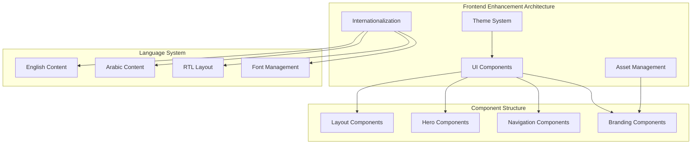
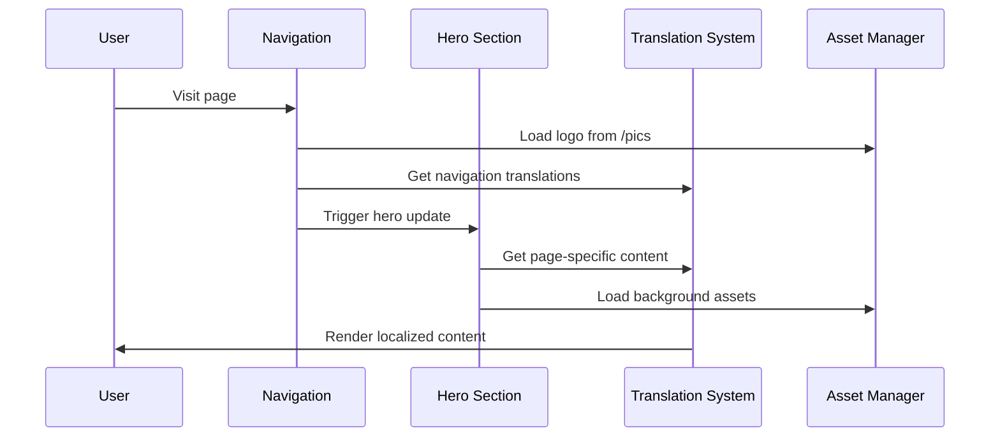

# Design Document

## Overview

The frontend UI enhancement design implements a comprehensive visual and functional improvement system for the consulting.sa development site. The design focuses on creating a cohesive, professional, and fully internationalized user experience while maintaining the existing architecture and ensuring development environment safety.

## Architecture

### High-Level Design Architecture



### Component Interaction Flow



## Components and Interfaces

### 1. Enhanced Logo and Branding System

**Purpose**: Centralized logo management with multi-language support
**Location**: `components/layout/enhanced-logo.tsx`

**Key Components**:
- Logo component with dynamic sizing
- Multi-language text rendering
- Responsive image handling
- PWA icon integration

**Interface**:
```typescript
interface EnhancedLogoProps {
  size?: 'sm' | 'md' | 'lg' | 'xl';
  showText?: boolean;
  variant?: 'header' | 'footer' | 'standalone';
  className?: string;
}

interface LogoAssets {
  main: string;
  pwa192: string;
  pwa512: string;
  favicon: string;
  highRes: string;
}
```

### 2. Transparent Navigation System

**Purpose**: Modern navigation with transparency and blur effects
**Location**: `components/layout/transparent-navigation.tsx`

**Key Components**:
- Scroll-based transparency
- Backdrop blur effects
- Smooth transitions
- Mobile-responsive design

**Interface**:
```typescript
interface TransparentNavigationProps {
  transparencyThreshold?: number;
  blurIntensity?: number;
  transitionDuration?: number;
}

interface NavigationState {
  isScrolled: boolean;
  isTransparent: boolean;
  scrollY: number;
}
```

### 3. Universal Hero Component

**Purpose**: Consistent hero sections across all pages
**Location**: `components/layout/universal-hero.tsx`

**Key Components**:
- Page-specific content injection
- Consistent styling and layout
- Multi-language support
- Responsive design

**Interface**:
```typescript
interface UniversalHeroProps {
  page: 'home' | 'services' | 'consulting' | 'about' | 'documentation' | 'contact';
  customTitle?: string;
  customSubtitle?: string;
  showCTA?: boolean;
  backgroundVariant?: 'default' | 'gradient' | 'pattern';
}

interface HeroContent {
  title: string;
  subtitle: string;
  ctaPrimary?: string;
  ctaSecondary?: string;
  backgroundImage?: string;
}
```

### 4. Enhanced Translation System

**Purpose**: Complete multi-language support with RTL handling
**Location**: `lib/enhanced-i18n.tsx`

**Key Components**:
- Extended translation keys
- RTL layout management
- Font switching
- Hydration-safe rendering

**Interface**:
```typescript
interface EnhancedTranslationContextType {
  locale: Locale;
  setLocale: (locale: Locale) => void;
  t: (key: string, params?: Record<string, string>) => string;
  isRTL: boolean;
  isLoaded: boolean;
  direction: 'ltr' | 'rtl';
}

interface TranslationConfig {
  fallbackLocale: Locale;
  supportedLocales: Locale[];
  rtlLocales: Locale[];
  fontMappings: Record<Locale, string>;
}
```

### 5. Asset Management System

**Purpose**: Optimized loading and management of images from /pics folder
**Location**: `lib/asset-manager.ts`

**Key Components**:
- Dynamic asset loading
- Format optimization (WebP support)
- Responsive image handling
- Caching strategies

**Interface**:
```typescript
interface AssetManagerConfig {
  basePath: string;
  supportedFormats: string[];
  cacheDuration: number;
  lazyLoading: boolean;
}

interface AssetMetadata {
  path: string;
  format: string;
  size: number;
  dimensions: { width: number; height: number };
  optimized: boolean;
}
```

## Data Models

### 1. Page Configuration Schema

```typescript
interface PageConfig {
  id: string;
  route: string;
  hero: {
    titleKey: string;
    subtitleKey: string;
    backgroundImage?: string;
    showCTA: boolean;
    ctaVariant: 'primary' | 'secondary' | 'both';
  };
  navigation: {
    order: number;
    visible: boolean;
    icon?: string;
  };
  seo: {
    titleKey: string;
    descriptionKey: string;
    keywords: string[];
  };
}
```

### 2. Translation Schema

```typescript
interface TranslationEntry {
  key: string;
  en: string;
  ar: string;
  context?: string;
  pluralization?: {
    en: { zero?: string; one: string; other: string };
    ar: { zero?: string; one: string; two?: string; few?: string; many?: string; other: string };
  };
}

interface TranslationNamespace {
  namespace: string;
  entries: TranslationEntry[];
  lastUpdated: string;
  version: string;
}
```

### 3. Theme Configuration

```typescript
interface ThemeConfig {
  colors: {
    primary: Record<string, string>;
    secondary: Record<string, string>;
    accent: Record<string, string>;
    neutral: Record<string, string>;
  };
  typography: {
    fonts: Record<Locale, string>;
    sizes: Record<string, string>;
    weights: Record<string, number>;
  };
  spacing: Record<string, string>;
  breakpoints: Record<string, string>;
  animations: {
    durations: Record<string, string>;
    easings: Record<string, string>;
  };
}
```

## Error Handling

### 1. Hydration Error Prevention

**Strategy**: Implement hydration-safe rendering patterns

**Implementation**:
- Use `useEffect` for client-only operations
- Implement proper loading states
- Separate server and client rendering logic
- Use `suppressHydrationWarning` judiciously

**Error Categories**:
- **Translation Hydration**: Mismatched server/client translations
- **Theme Hydration**: Theme switching during SSR
- **Dynamic Content**: Client-specific content rendering

### 2. Translation Fallback System

**Fallback Hierarchy**:
1. Requested translation in current locale
2. Fallback to English translation
3. Return translation key as fallback
4. Log missing translation for future addition

**Implementation**:
```typescript
function getTranslation(key: string, locale: Locale): string {
  try {
    return translations[locale]?.[key] || 
           translations['en']?.[key] || 
           key;
  } catch (error) {
    console.warn(`Translation error for key: ${key}`, error);
    return key;
  }
}
```

### 3. Asset Loading Error Handling

**Strategy**: Graceful degradation with fallback assets

**Implementation**:
- Fallback to different image formats
- Placeholder images for failed loads
- Retry mechanisms for network failures
- Error reporting for missing assets

## Testing Strategy

### 1. Visual Regression Testing

**Tools**: Playwright with visual comparisons
**Coverage**:
- Hero sections across all pages
- Navigation transparency states
- Multi-language layouts
- Responsive breakpoints

**Test Structure**:
```typescript
test.describe('Visual Regression Tests', () => {
  test('Hero sections consistency', async ({ page }) => {
    const pages = ['/', '/services', '/consulting', '/about'];
    for (const route of pages) {
      await page.goto(route);
      await expect(page.locator('.hero-section')).toHaveScreenshot(`hero-${route.slice(1) || 'home'}.png`);
    }
  });
});
```

### 2. Multi-language Testing

**Test Coverage**:
- Translation completeness
- RTL layout correctness
- Font loading and display
- Content overflow handling

**Test Implementation**:
```typescript
test.describe('Multi-language Support', () => {
  test('Complete Arabic translation', async ({ page }) => {
    await page.goto('/');
    await page.click('[data-testid="language-switcher"]');
    await page.click('[data-testid="arabic-option"]');
    
    // Verify no English text remains
    const englishText = await page.locator('text=/[a-zA-Z]{3,}/').count();
    expect(englishText).toBe(0);
  });
});
```

### 3. Performance Testing

**Metrics**:
- First Contentful Paint (FCP)
- Largest Contentful Paint (LCP)
- Cumulative Layout Shift (CLS)
- Time to Interactive (TTI)

**Targets**:
- FCP < 1.5s
- LCP < 2.5s
- CLS < 0.1
- TTI < 3s

## Implementation Phases

### Phase 1: Logo and Branding (Week 1)
- Implement enhanced logo component
- Set up asset management system
- Create responsive logo variants
- Test across different screen sizes

### Phase 2: Navigation Enhancement (Week 1-2)
- Implement transparent navigation
- Add scroll-based transparency
- Implement backdrop blur effects
- Test mobile responsiveness

### Phase 3: Hero Section Standardization (Week 2)
- Create universal hero component
- Implement page-specific content
- Ensure consistent styling
- Test across all pages

### Phase 4: Translation System Enhancement (Week 2-3)
- Extend translation keys
- Fix hydration issues
- Implement proper RTL support
- Test language switching

### Phase 5: Performance and Accessibility (Week 3)
- Optimize asset loading
- Implement accessibility features
- Performance testing and optimization
- Final testing and validation

## Development Environment Safety

### Container Isolation
- All changes deployed to development containers only
- Port separation: dev (3001) vs prod (3000)
- Environment-specific configurations
- Safe rollback procedures

### Testing Protocol
- Local development testing
- Development container validation
- Staging environment verification
- Production environment protection

### Deployment Strategy
- Development-first approach
- Incremental feature deployment
- Health check validation
- Rollback capability maintenance